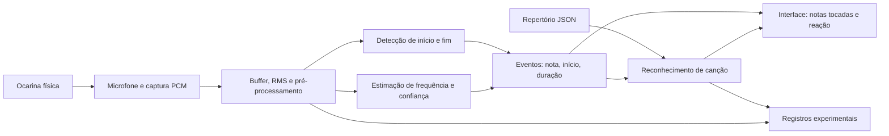

# Ocarina Beat — MVP de PDS

Jogo musical em que o jogador toca canções curtas numa **ocarina real**. O microfone capta o áudio, o processamento digital de sinais (PDS) reconhece as notas e o ritmo e, quando a canção está certa, o jogo reage.

Tema: **Proposta 3 – Sistema de resposta a melodias**.

## Sumário

1. [Proposta](#1-proposta)
2. [Escopo](#2-escopo)
3. [O que vamos implementar](#3-o-que-vamos-implementar)
4. [Fundamentação teórica](#4-fundamentação-teórica)
5. [Atendimento aos requisitos do projeto](#5-atendimento-aos-requisitos-do-projeto)
6. [Validação](#6-validação)
7. [Plano de trabalho](#7-plano-de-trabalho)
8. [Estrutura do repositório](#8-estrutura-do-repositório)
9. [Convenções](#9-convenções)

## 1. Proposta

O enunciado pede um sistema que reconheça uma sequência musical previamente definida e produza uma **reação inequívoca** quando a sequência correta for executada, envolvendo **ordem, intervalos e duração/ritmo conhecidos**.

Nossa variação: o jogador toca uma canção numa **ocarina física**. O sistema:

1. captura o som pelo microfone;
2. estima a frequência fundamental e segmenta as notas (início, fim e duração);
3. compara as notas e o ritmo com um repertório de canções conhecidas;
4. dispara uma reação clara (visual e sonora) se a canção estiver correta; se estiver errada ou incompleta, **nada** dispara e o jogo mostra onde a execução divergiu.

Descrição curta:

> Toque uma canção na sua ocarina e veja o jogo responder. O Ocarina Beat usa processamento digital de sinais para reconhecer as notas e o ritmo que você toca.

### Modos de jogo

| Modo | Função | Prioridade |
| --- | --- | --- |
| **Aprender** | Mostra a canção, toca uma referência sonora (em fones) e pede para o jogador repetir. Indica qual nota ou ritmo divergiu. | Núcleo |
| **Tocar livre** | Escuta continuamente, mostra as notas reconhecidas e dispara a reação quando as últimas notas formam uma canção do repertório. Melodia desconhecida não dispara nada. | Núcleo |
| **Desafio rítmico** | Pista de notas no estilo jogos de ritmo, com tempo. | Opcional |

## 2. Escopo

- Entrada por **ocarina física** via microfone.
- Uma nota por vez, sem acordes.
- Repertório de **3 a 4 canções originais** de 5 a 8 notas, incluindo um par com o mesmo começo (para testar rejeição por coincidência parcial), uma com nota repetida e uma com nota longa.
- Modos Aprender e Tocar livre, interface 2D simples.
- Validação quantitativa e artigo técnico.

**Extensões opcionais (só com o núcleo validado):** assobio (comparação por intervalos relativos), desafio rítmico, controle de velocidade no modo Aprender, mais canções.

## 3. O que vamos implementar

### Cadeia de processamento



### Módulos

| Módulo | Responsabilidade |
| --- | --- |
| Captura | Dispositivo, taxa de amostragem efetiva, canais, amostras e perdas. |
| Buffer e pré-processamento | Janelamento, remoção de componente contínua, RMS, filtragem FIR/IIR justificada. |
| Estimador de frequência | f0 e indicador de confiança por janela: FFT com janela Hann (com interpolação do pico) comparada a autocorrelação/YIN. |
| Segmentador | Estados silêncio → ataque → nota ativa → liberação; separa nota sustentada de notas repetidas. |
| Reconhecedor | Compara as últimas notas com cada canção (notas + razões de duração); decide: reconhecida, nenhuma, ou onde divergiu. |
| Sessão e jogo | Modos Aprender e Tocar livre, histórico de notas, reinício após erro, reação. |
| Interface | Símbolos das notas, feedback de divergência, tela de diagnóstico (nível, frequência, nota). |
| Registro | Configuração, eventos e métricas por sessão, para validação. |

### Possível Stack

Desenvolvimento em **Linux**, aplicação desktop, processamento local. Proposta mais simples: **Python** (NumPy/SciPy para o PDS, `sounddevice` para captura via PortAudio, `pygame` para a interface 2D). Alternativa: Godot para a interface e Python para a bancada experimental.

### Formato do repertório

Cada canção é uma lista de notas MIDI com durações relativas em batidas, sem instantes absolutos (a canção pode começar em qualquer momento e em andamento razoável). Os intervalos são derivados das notas, então o mesmo arquivo serve ao modo absoluto (ocarina) e ao relativo (assobio, no futuro).

```json
{
  "schema_version": 1,
  "id": "cancao_autoral_01",
  "name": "Canção da Lanterna",
  "reference_a4_hz": 440.0,
  "notes": [
    {"midi": 72, "beats": 1},
    {"midi": 76, "beats": 1},
    {"midi": 79, "beats": 2},
    {"midi": 76, "beats": 1}
  ],
  "reaction": "lanterna_acende"
}
```

(Valores ilustrativos; o repertório real depende da extensão da ocarina.)

### Regras de decisão (proposta)

- Uma canção só é reconhecida se **todas** as notas estiverem certas, na ordem, com ritmo proporcional dentro da tolerância.
- Se uma canção é o começo de outra, espera-se uma pausa curta antes de decidir.
- Depois de um erro no modo Aprender, recomeça-se do início da canção.
- Uma nota sustentada só conta como duas se houver nova articulação (queda de energia ou novo ataque).
- Não informar nota quando o estimador não tem evidência suficiente; falha de captura não é erro musical.

## 4. Fundamentação teórica

Para cada tópico, onde ele entra no projeto.

### 4.1 Amostragem

O áudio é uma sequência `x[n] = x(nT)`, com `T = 1/fs`, e o tempo de cada amostra é `n/fs`. Pelo critério de Nyquist, `fs ≥ 2·fmax`; abaixo disso há aliasing, que não dá para desfazer depois.

**Onde entra:** justificar a taxa de captura (requisito 2 do enunciado). As fundamentais da ocarina ficam abaixo de alguns kHz (uma alto em Dó de 12 furos vai de ~440 Hz a ~1.400 Hz), então 44,1 ou 48 kHz sobram. Se decidirmos decimar para 16 kHz para reduzir custo, será preciso um filtro anti-aliasing antes. Também serve para gerar os sinais sintéticos de teste (senoides com `ω0 = 2πf/fs`).

### 4.2 Energia e filtros

- **RMS por janela:** `RMS = sqrt((1/N) Σ x[n]²)`.
- **Filtros FIR e IIR:** `y[n] = Σ b_k x[n−k]` (FIR); com realimentação, `Σ a_k y[n−k] = Σ b_k x[n−k]` (IIR). A filtragem é a convolução da entrada com a resposta ao impulso, e `H(ω)` diz como cada frequência é alterada.

**Onde entra:**
- O RMS, com limiar e histerese, decide se há som e marca início e fim de cada nota (silêncio, fala baixa e ruído de fundo não podem virar nota).
- Um passa-altas ou passa-faixa FIR/IIR remove ruído grave (ventilador, vibração do suporte) antes do estimador. Será preciso conferir que a banda escolhida não corta as notas mais graves da ocarina.
- Uma média móvel suaviza a curva de frequência entre janelas.
- Estabilidade: se o jogo tocar a referência por alto-falante, o som volta ao microfone e pode gerar microfonia. Por isso a referência do modo Aprender sai em fones.

### 4.3 DFT e FFT

A DFT amostra N pontos do espectro: `X[k] = Σ x[n] e^{−j2πkn/N}`, com bins espaçados de `Δf = fs/N`. A FFT calcula isso em O(N log N). A janela de Hann reduz o vazamento espectral ao custo de um lóbulo principal mais largo, e zero-padding não aumenta a resolução física.

**Onde entra:** é o método de referência para estimar a frequência fundamental. Com `fs = 48 kHz` e `N = 2048`, `Δf ≈ 23,4 Hz`, quase um semitom em A4 (~26 Hz), então nas notas graves a resolução é o ponto crítico. Vamos testar interpolação parabólica do pico, janelas maiores (com mais atraso) e o método temporal da seção 4.5. Como a ocarina soa quase como uma senoide, o pico da FFT tende a ser a fundamental, mas erros de oitava ainda podem acontecer e serão medidos.

### 4.4 Transformada Z

Polos, zeros e região de convergência descrevem um filtro. Um sistema causal só é estável com os polos dentro do círculo unitário; filtros FIR têm só zeros e são sempre estáveis.

**Onde entra:** projetar e verificar a estabilidade dos filtros IIR usados no pré-processamento. Se usarmos só FIR, essa parte se reduz a justificar por que são estáveis.

### 4.5 Frequência, nota e cents

Posição MIDI `m = 69 + 12·log2(f/440)`; frequência da nota `f(k) = 440·2^((k−69)/12)`; desvio em cents `e = 1200·log2(f/f_ref)`.

**Onde entra:** converter a frequência estimada em nota e medir o quanto ela está desafinada. A comparação com o repertório usa a nota esperada, não só o arredondamento para a mais próxima, com tolerância inicial de ±50 cents.

### 4.6 Autocorrelação e YIN

Na autocorrelação, o atraso `τ` com maior semelhança entre o sinal e ele mesmo dá `f0 = fs/τ`. É preciso restringir `τ` à faixa do instrumento e tratar múltiplos e submúltiplos do período. O YIN (de Cheveigné e Kawahara, 2002) usa uma função de diferença normalizada, com limiar e refinamento, e é mais robusto a erros de oitava.

**Onde entra:** é o segundo estimador, comparado à FFT nos mesmos arquivos (experimento E04). Este é um tópico que precisa de estudo próprio além do conteúdo da disciplina.

### 4.7 Segmentação de notas

Máquina de estados: silêncio, ataque, nota ativa, liberação. A nota é confirmada quando energia, frequência e periodicidade ficam consistentes por alguns quadros. Nota repetida da mesma altura só é detectada por rearticulação (queda de energia ou novo ataque), porque a frequência não muda.

**Onde entra:** transforma a curva de frequência por janela em eventos (nota, início, duração), que é o que o reconhecedor recebe. Responde à pergunta do enunciado sobre nota sustentada × nota repetida. O instante de início vem da energia e é confirmado depois, pois o estimador só estabiliza alguns quadros depois do ataque. Também exige estudo próprio (detecção de onset).

### 4.8 Comparação com o repertório

- **Absoluta (ocarina):** notas MIDI e razões de duração. Cada duração é dividida pela duração média, tanto na execução quanto na canção, e as razões são comparadas com uma tolerância. Assim o reconhecimento não depende do andamento.
- **Relativa (assobio, extensão):** intervalos `12·log2(f[i+1]/f[i])` em semitons, que permitem tocar em outra altura.
- **Alinhamento:** associação um-para-um e monotônica entre eventos tocados e esperados, para que uma nota extra ou perdida não desloque o resto.

**Onde entra:** no reconhecedor, que decide entre canção reconhecida, nenhuma, ou divergência (com a posição da primeira nota errada, para o feedback do modo Aprender). No modo Tocar livre, o reconhecedor roda sobre o final do histórico de notas. A exigência de todos os eventos, na ordem, é o que evita aceitação por coincidência parcial.

## 5. Atendimento aos requisitos do projeto

### Requisitos mínimos comuns do enunciado

| # | Exigência | Como será atendida |
| --- | --- | --- |
| 1 | Sinal real adquirido pela equipe | Ocarina física gravada nos ensaios e tocada ao vivo na demonstração. |
| 2 | Frequência de amostragem identificada e justificada | Registro da taxa efetiva (44,1/48 kHz) e justificativa por Nyquist (seção 4.1). |
| 3 | Etapa explícita de PDS | Janelamento, filtragem, FFT/autocorrelação/YIN, segmentação. |
| 4 | Decisão/estimativa quantitativa | Frequência, nota, cents, durações e comparação com o repertório. |
| 5 | Saída ou resposta observável | Notas na tela, reação à canção correta, indicação de onde divergiu. |
| 6 | Testes e critérios de validação | Banco real, erros controlados e métricas (seção 6). |
| 7 | Embasamento teórico | Seção 4 e artigo. |
| 8 | Documentação de arquitetura, método, parâmetros, resultados, limitações e decisões | Este README, registro de sessões e artigo. |

### Perguntas de projeto do enunciado (Proposta 3)

| Pergunta | Resposta proposta |
| --- | --- |
| Reconhecimento absoluto ou relativo? | Absoluto (notas + durações proporcionais) para a ocarina; relativo para o assobio, se adicionado. |
| Qual tolerância de afinação? | Inicial ±50 cents; testar ±25 e ±35. |
| Ritmo exato ou proporcional? | Proporcional, por razões de duração, com tolerância a medir. |
| Como voltar ao início após um erro? | Recomeçar do início da canção (modo Aprender). |
| Como distinguir nota sustentada de nota repetida? | Exigir nova articulação (queda de energia ou novo ataque). |
| Como evitar aceitação por coincidência parcial? | Exigir todos os eventos, na ordem; esperar pausa quando uma canção é prefixo de outra; medir falsa aceitação. |

### Entregáveis

- [ ] Ficha de cadastro aprovada pelo professor (preenchida em `docs/proposta.pdf`, faltam os RAs).
- [ ] Protótipo funcional ou demonstrador executável.
- [ ] Código-fonte organizado e comentado.
- [ ] Dados de teste ou exemplos para reproduzir a demonstração.
- [ ] Artigo técnico (problema, fundamentação, arquitetura, métodos, experimentos, resultados, limitações, conclusões).
- [ ] Demonstração final ponta a ponta com critérios de validação.

### Requisitos funcionais do MVP

| ID | Requisito |
| --- | --- |
| RF01 | Capturar a ocarina física pelo microfone. |
| RF02 | Informar dispositivo e frequência de amostragem efetivamente usados. |
| RF03 | Estimar frequência fundamental e nota. |
| RF04 | Segmentar eventos musicais com início, fim e duração. |
| RF05 | Carregar canções do repertório (notas e durações relativas). |
| RF06 | Comparar execução e padrão por notas e ritmo proporcional. |
| RF07 | Reação inequívoca à canção correta; nenhuma à incorreta. |
| RF08 | Mostrar as notas reconhecidas e onde a execução divergiu. |
| RF09 | Reconhecer ausência de sinal confiável (silêncio, fala e ruído não viram notas). |
| RF10 | Gerar registros para validação. |

## 6. Validação

Nenhum teste foi executado ainda; as metas abaixo são pontos de partida a negociar depois da linha de base.

**Dados:** notas sustentadas da ocarina (5 notas × 5 repetições × 2 executantes), transições, notas repetidas, sequências corretas, erros controlados (nota trocada, ritmo errado, canção pela metade, canção de mesmo começo), silêncio, fala e ruído. Áudios originais preservados; sessões de ajuste separadas das de avaliação final.

**Métricas**

| Aspecto | Medida |
| --- | --- |
| Nota | Acurácia e matriz de confusão. |
| Frequência | Erro em cents (mediana e P95), onde houver referência. |
| Eventos | Precisão, revocação e F1 com pareamento um-para-um. |
| Onset | Erro de início em ms (mediana e P95). |
| Canção | Taxa de reconhecimento, **taxa de falsa aceitação**, matriz de confusão entre canções. |
| Silêncio/ruído | Falsos eventos por minuto. |
| Latência | Tempo entre o evento acústico e o feedback visível. |

**Metas iniciais propostas:** reconhecimento ≥ 90%, falsa aceitação ≤ 5%, acurácia de nota ≥ 90%, F1 de eventos ≥ 0,85, P95 de latência ≤ 200 ms, no máximo 1 falso evento por minuto de silêncio.

**Experimentos:** (E01) sintéticos e silêncio; (E02) notas reais; (E03) repetição, legato e pausas; (E04) comparação de métodos de f0; (E05) janela, salto e confirmação; (E06) distância, intensidade e ruído; (E07) erros controlados; (E08) ponta a ponta ao vivo; (E09) pausa e captura interrompida.

## 7. Plano de trabalho

| Fase | Conteúdo | Saída |
| --- | --- | --- |
| 0 | Caracterizar a ocarina, testar captura no Linux, definir repertório, submeter a ficha. | Ficha aprovada e ambiente funcionando. |
| 1 | Captura e frequência: tela de diagnóstico; FFT (Hann, com/sem interpolação) × autocorrelação. | Notas do repertório reconhecidas com confiança. |
| 2 | Eventos e ritmo: segmentação, nota sustentada × repetida, latência. | Sequência de notas com durações e qualidade medida. |
| 3 | Reconhecimento de canções e jogo: modos Aprender e Tocar livre, reação. | RF01–RF10 com evidência. |
| 4 | Validar e entregar: congelar configuração, experimentos, artigo, demonstração. | MVP e material acadêmico entregues. |
| 5 | Extensões opcionais: assobio, desafio rítmico. | Só com o núcleo pronto. |

**Riscos principais:** crescimento de escopo (o MVP é o filtro); resolução insuficiente da FFT nas notas graves (testar interpolação, janela maior, autocorrelação); falsa aceitação entre canções parecidas (par de mesmo começo no repertório); microfone diferente na demonstração (testar no equipamento real); melodias fora da extensão da ocarina (definir repertório após caracterizá-la).
